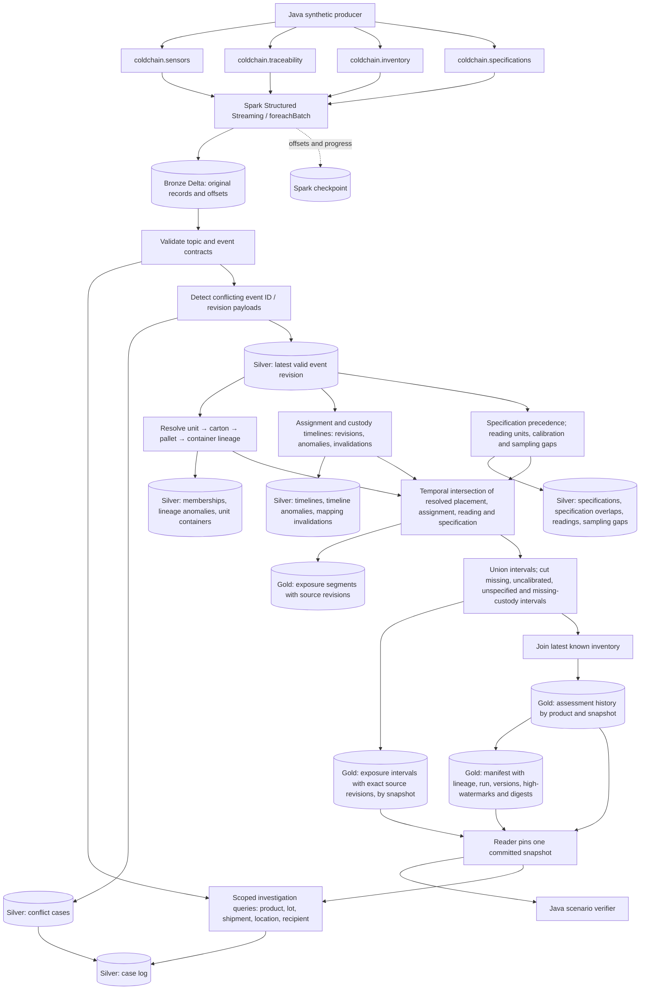
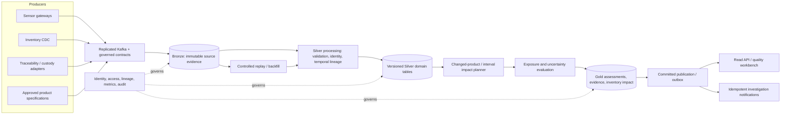

# Cold-chain intelligence architecture

Version 1.0 | Design baseline | 05 November 2026

## Purpose and scope

Identify serialized products potentially exposed to out-of-range conditions, locate the latest known inventory, and preserve how an assessment changed after late or corrected evidence. Assessments support authorized quality review; they do not determine clinical suitability or automatically issue recalls. All demo data and thresholds are synthetic.

The prototype uses Java 17, Spark 3.5.7, Kafka 3.9.1 and Delta Lake 3.3.3. It has three passing local Spark transformation tests. Container integration and production readiness are separate validation gates. The design below explicitly separates implemented behavior from planned capabilities.

## Current logical architecture

One Spark local[2] application executes one micro-batch callback at a time. Kafka has four topics with four partitions, seven-day retention and replication factor one. Bronze is merged by topic/partition/offset. Silver tables are rebuilt from Bronze. The elementary measured segments are persisted in gold/exposure_segments and the merged intervals behind every Gold duration in gold/exposure_intervals, keyed by snapshot; the other interval datasets are temporary Spark SQL views. Gold history is insert-only by product/snapshot; a commit manifest is appended last. Readers must pin a committed snapshot before reading history.

## Proposed production architecture

Proposed: managed Spark executors, shared object storage, replicated Kafka, versioned schema management, controlled replay, a read API and an idempotent publication outbox. No cloud provider, managed vendor, orchestration engine or UI is selected yet. These are architecture requirements, not claims of deployed services.

## Processing workflow

1. Ingest raw JSON from four Kafka topics; preserve source coordinates and broker timestamps.
2. Merge raw records into Bronze before applying business interpretation.
3. Validate event-specific fields and expected topic; persist invalid source records to quarantine with a reason code for every broken rule.
4. Open a conflict case for any competing payload for an event ID/revision, or an ID reused across kinds; block the entire ID while a case is open. A higher revision from the source resolves a payload conflict. Record each case's opening and resolution in the case log. Preserve all source evidence in Bronze.
5. Select the highest valid revision for each non-conflicting event ID. A correction retains the ID and increments revision.
6. Materialize canonical Silver events, then read that persisted snapshot for assessment calculations.
7. Resolve packaging lineage: follow unit → carton → pallet → container memberships that overlap in time; report contradictory parents, level mismatches and cycles, and leave those memberships out.
8. Keep every assignment and custody revision with provenance; report a sensor in two containers or two custodians at once and leave those out; list the units each assignment correction affects on both its former and revised side.
9. Intersect the resolved product placement, sensor/container assignment, measured interval and product specification validity.
10. Union overlapping intervals independently for each metric (expected presence, coverage, excursion, calibration, specification, custody); cut missing, uncalibrated, unspecified and missing-custody time as interval differences. Persist every interval with the exact revisions of its source events, and sum seconds only from those intervals.
11. Apply the illustrative excursion rule; carry missing coverage and latest inventory context.
12. Insert interval evidence and product assessments keyed by snapshotId, after deleting any rows an unpublished attempt left; write the manifest only after all of them succeed. A batch already published writes nothing.
13. Consumers select max committed snapshotId and read only matching assessment-history records.
14. On late evidence or correction, compare the new canonical events with the previous snapshot's. Recompute in Gold only the units the changes can affect, on both their old and new values, from the events those units depend on. Write their rows and tombstones as a change log; a snapshot's state is each unit's newest row. Bronze parsing and Silver are still rebuilt in full. `Replay` recomputes everything into an isolated namespace as the reference.

## Business behavior and acceptance scenario

UNIT-A and UNIT-B share product code DRUG-DEMO and lot LOT-1, but occupy BOX-A and BOX-B. UNIT-D is in CARTON-1 on PALLET-1 in BOX-A, so it reaches BOX-A only through packaging lineage and must behave exactly like UNIT-A. The correction must list UNIT-A and UNIT-D as formerly mapped and UNIT-B as newly mapped. BOX-A passes from CARRIER-1 to WAREHOUSE-1 at 12:05 with no custody gap; BOX-B has no recorded custodian (600 missing custody seconds). A synthetic sensor reports 12 C for a measured ten-minute interval. The illustrative specification permits 2-8 C and 60 cumulative excursion seconds. Revision 1 assigns the sensor to BOX-A: A requires quality review, B has insufficient data. Revision 2 corrects the assignment to BOX-B: B requires review and A becomes insufficient-data. Both published assessments remain discoverable by snapshot. One duplicate reading must not increase the measured 600 seconds. These values are demo inputs, not handling guidance for medicines.

## Boundaries and non-goals

Implemented: explicit measured intervals, direct product-to-container placements, nested carton/pallet lineage with split/merge/repack over time and anomaly detection, sensor assignment revisions, cumulative excursion and coverage, latest known inventory, source quarantine, retained assessments and local tests.

Implemented also: revisioned sensor assignment and container custody timelines with ambiguity detection and correction impact. Implemented also: interval evidence for every Gold duration with the exact revision, payload hash and Bronze coordinates of each source event. Planned: custody transfer acknowledgements, calibration provenance, deletions/retractions, validated product-specific exposure models, regional/tenant isolation, real CDC connectors, clinical/quality approvals, query API, dashboards, notification delivery, incremental impact processing and comprehensive integration/recovery tests.
